# ✈️ EaseMyTrip – Flight Booking Web Application

A full-stack flight booking web application inspired by EaseMyTrip, developed to provide users with a convenient flight booking experience. The application includes flight search, user authentication, booking functionality, simulated payment processing, and an admin dashboard.

## 📌 About the Project

EaseMyTrip is a flight booking web application that allows users to search for flights based on their travel preferences, view available flights, and complete a simulated booking process.

The application also provides an administrative dashboard to manage flight details, registered users, and booking-related information.

## 🛠️ Technologies Used

| Category | Technologies |
|---|---|
| Frontend | HTML5, CSS3, JavaScript |
| Backend | Node.js, Express.js |
| Database | MongoDB |
| ODM | Mongoose |
| Tools | Visual Studio Code, MongoDB Compass, Git, GitHub |

## ✨ Features

### 👤 User Module

- User registration and login.
- Search flights by source and destination.
- Select travel date and travel class.
- Choose the number of adults and infants.
- View available flights.
- Apply discount coupon codes.
- Simulated payment process.
- Generate booking bills.

### 🔐 Admin Module

- Admin login.
- View registered users.
- Add new flight details.
- Update existing flight information.
- Delete flight details.
- Manage flight records.
- View revenue dashboard.

## 📸 Project Screenshots

### 1. Home Page

The landing page provides the flight search interface and booking options.

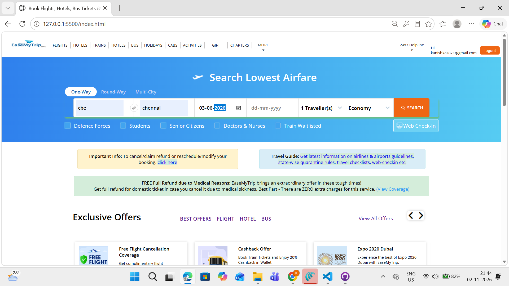


### 2. Flight Search and Booking

Users can enter their travel details and search for available flights.

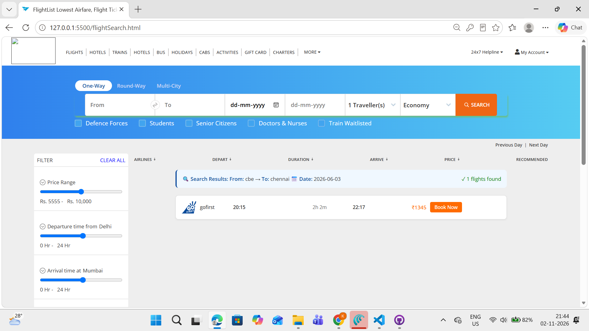

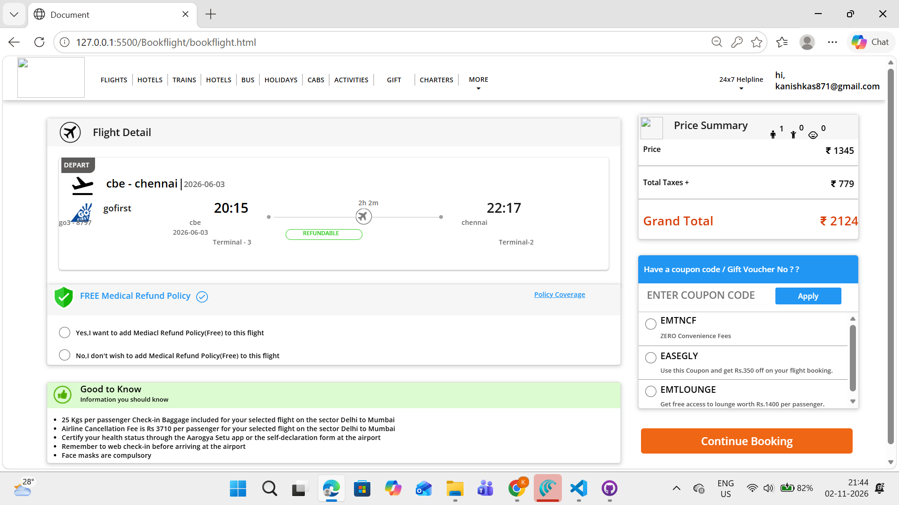

### 3. User Authentication

User registration and login interfaces.

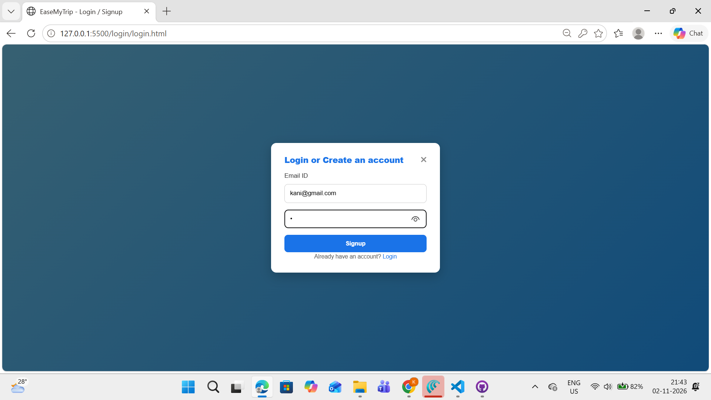

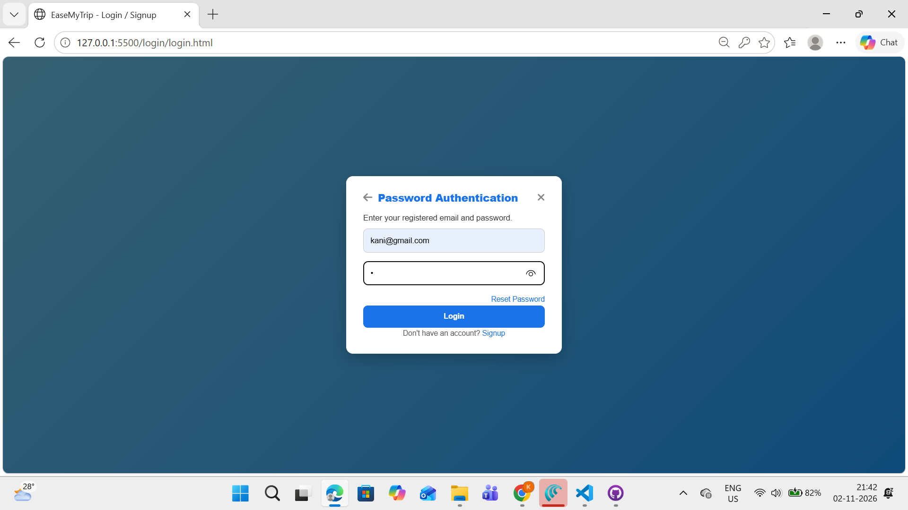

### 4. Admin Authentication

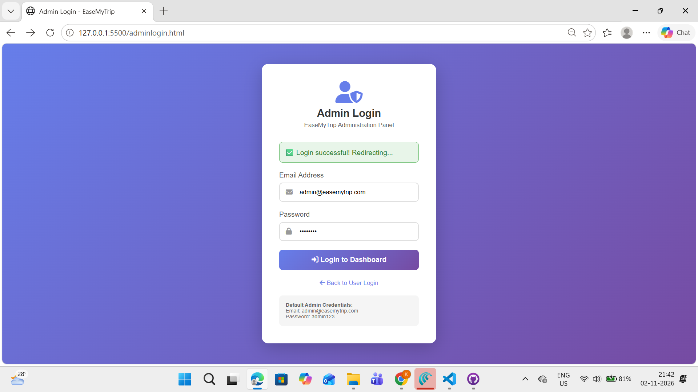

### 5. Admin Dashboard


### 6. User Management

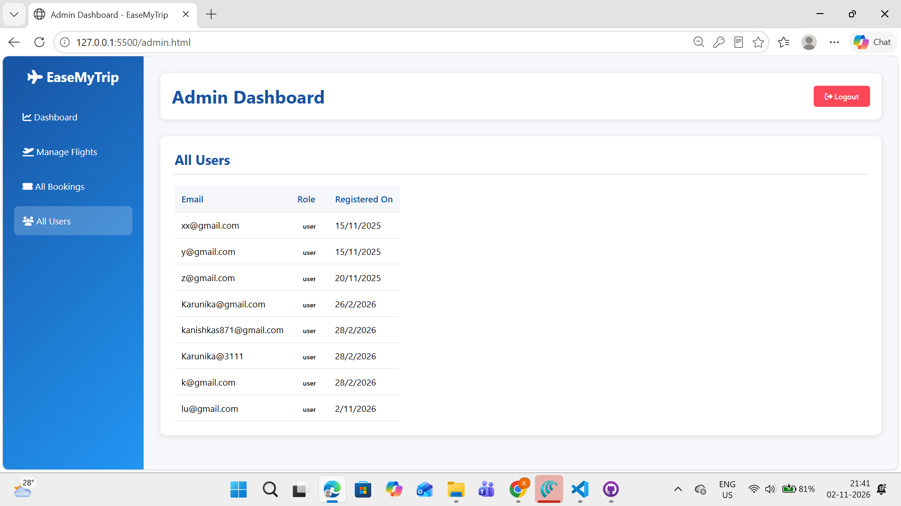

### 7. Flight Management – CRUD Operations

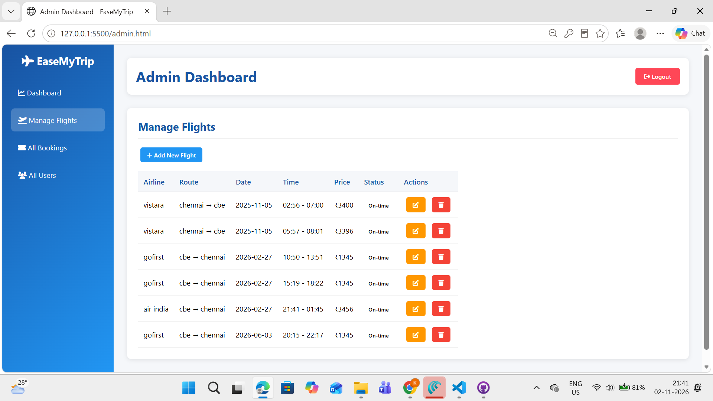

### 8. Booking Details

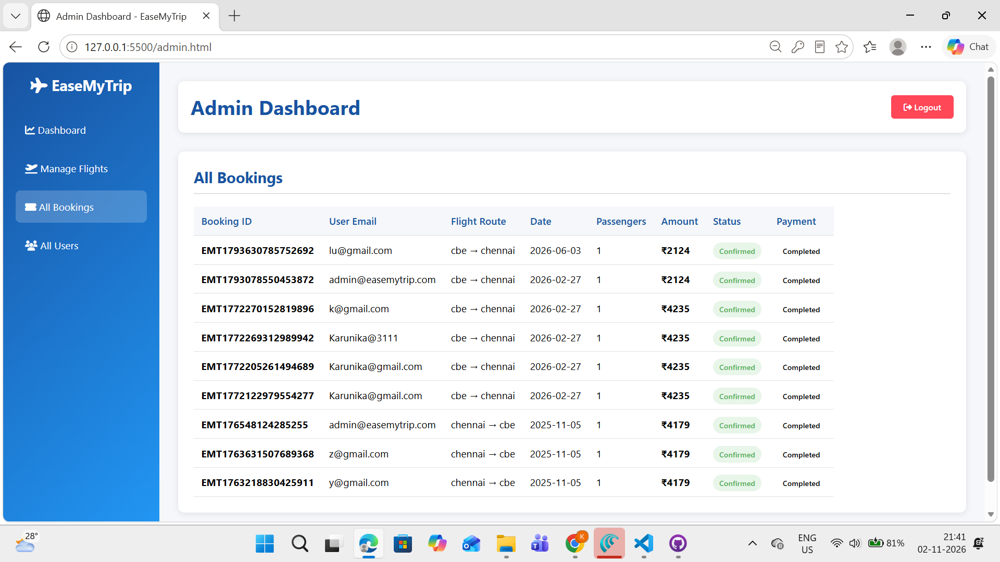

### 9. Payment and Bill Generation

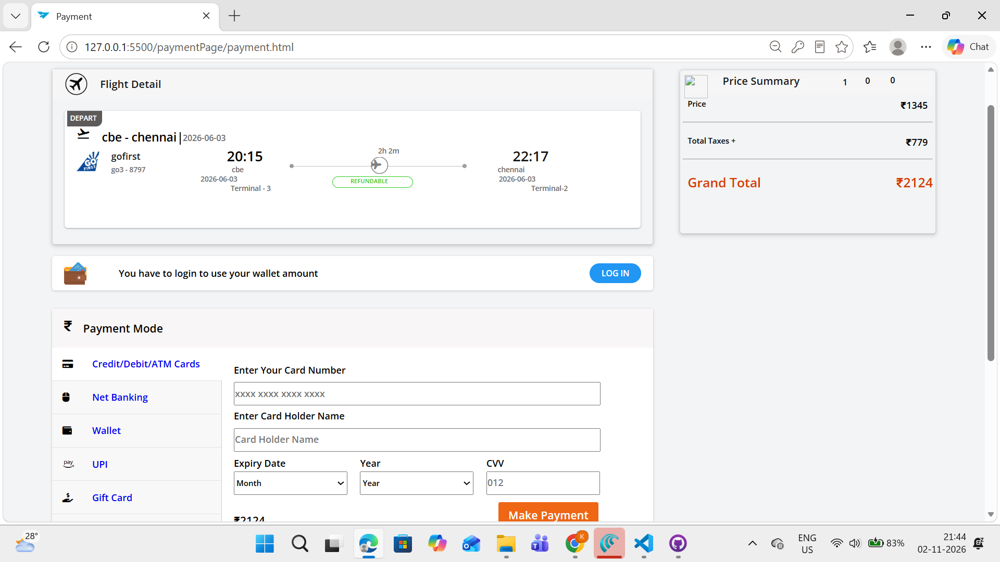

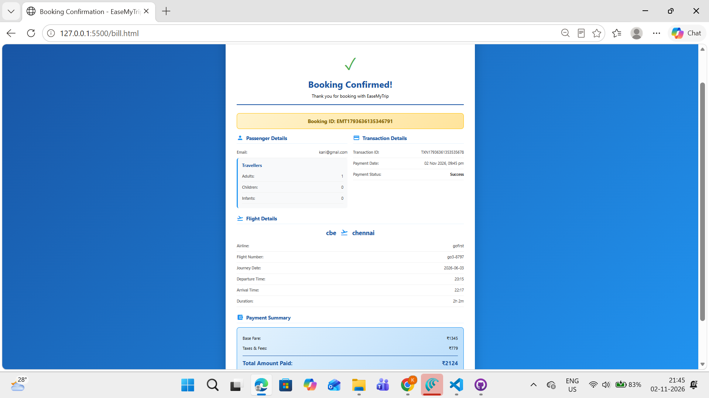

### 10. Database Management

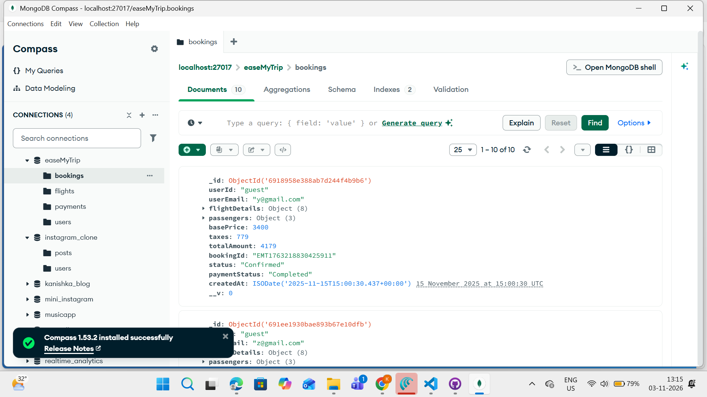

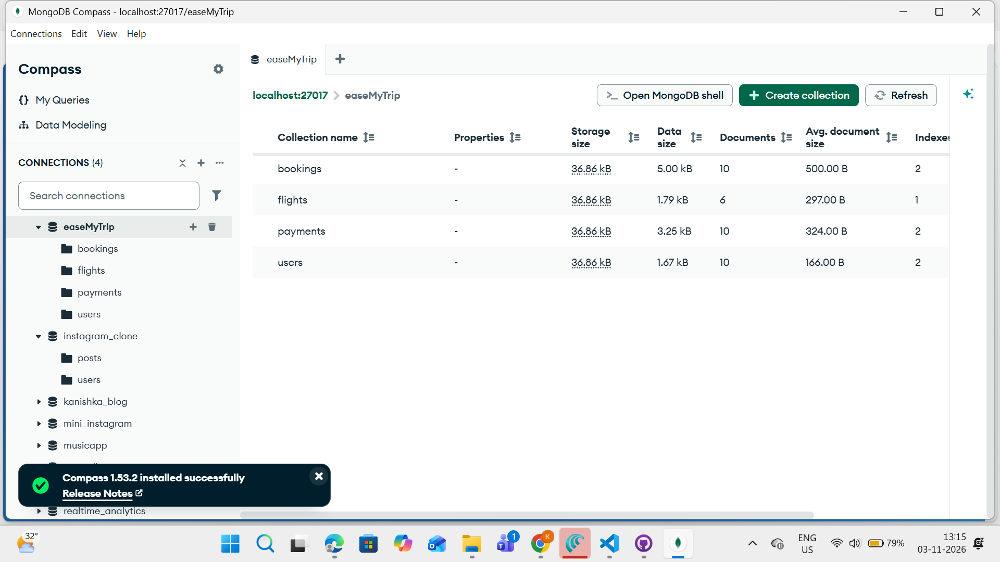

## ⚙️ Installation and Setup

### 1. Clone the Repository

```bash
git clone https://github.com/Kanishka-0306/EaseMyTripp.git
```

### 2. Navigate to the Project Directory

```bash
cd EaseMyTripp
```

### 3. Install Dependencies

```bash
npm install
```

### 4. Configure MongoDB

Ensure MongoDB is running and configure the database connection according to the project settings.

### 5. Start the Application

```bash
node index.js
```

### 6. Open in Browser

```text
http://localhost:5005
```

## 🎯 Learning Outcomes

- Gained practical experience in full-stack web development.
- Learned backend development using Node.js and Express.js.
- Implemented CRUD operations using MongoDB and Mongoose.
- Understood frontend and backend integration.
- Gained knowledge of database management and application workflows.

## 🚀 Future Enhancements

- Responsive design for mobile and tablet devices.
- Integration of a real payment gateway.
- Improved flight booking and seat management functionality.

---

**Developed using HTML, CSS, JavaScript, Node.js, Express.js, and MongoDB.**
